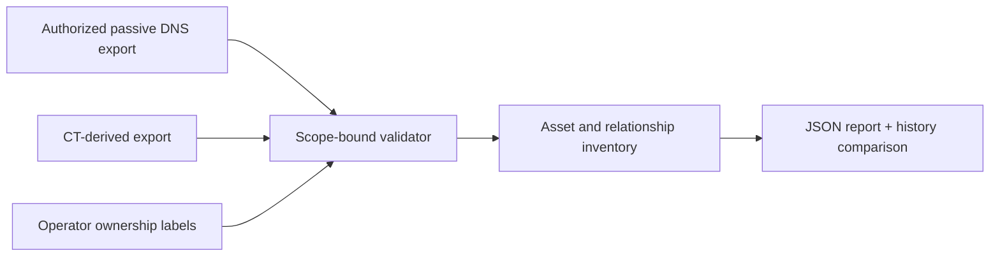

# Architecture and threat model

The operator supplies an approved parent domain and local source exports. The importer normalizes hosts, rejects out-of-scope names, retains source timestamps and raw-line hashes, and produces a deduplicated asset inventory and relationship list. A prior report can be compared only when its schema version and scope match. No DNS, CT, HTTP, or port request occurs.

Threats include out-of-scope discovery, false ownership, sensitive TXT disclosure, malformed export exhaustion, and treating a public IP as an exposed service. Controls include exact suffix matching, byte/line/record caps, TXT omission, source assertion labels, and no network capability. Remaining risk: CT inclusion is not verified, upstream source authenticity is not checked, and source timestamps are trusted assertions.
